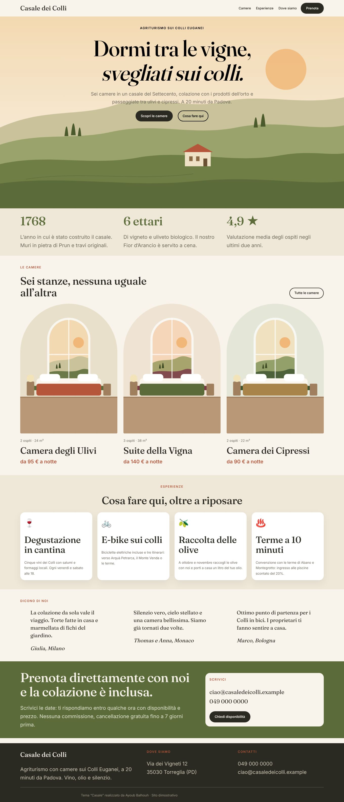
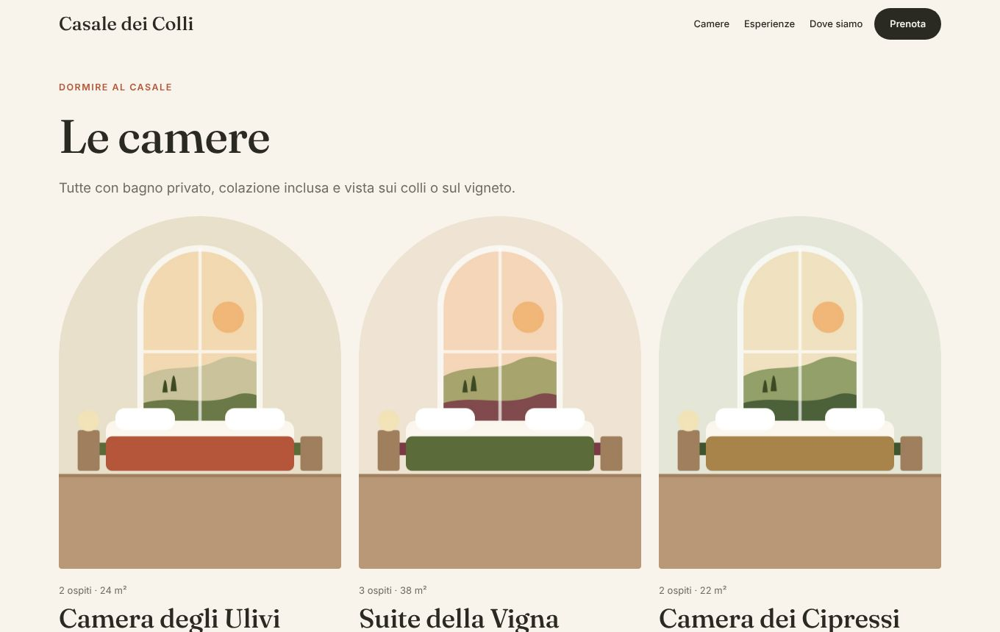
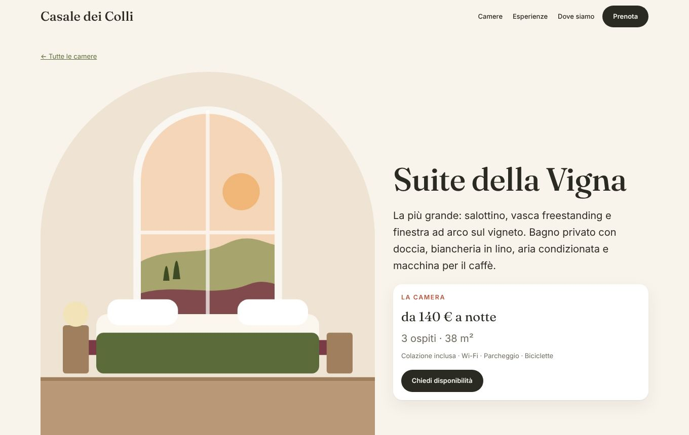
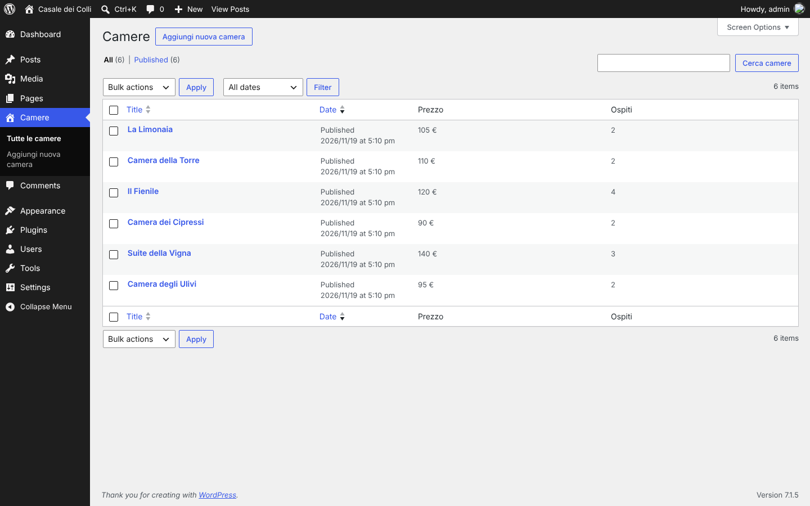
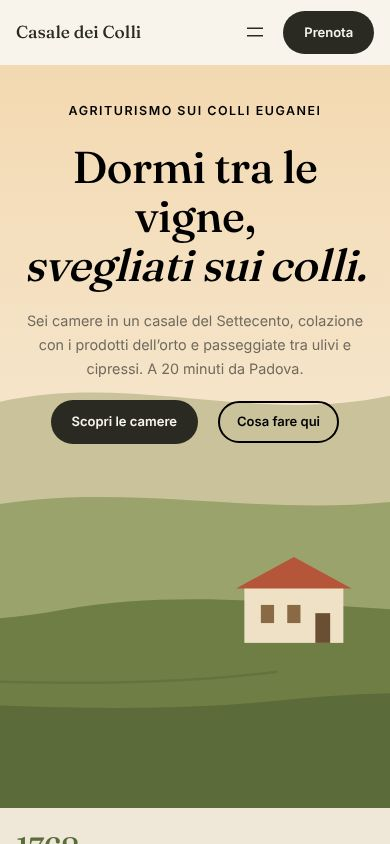

# Casale · Tema WordPress a blocchi

Tema WordPress per agriturismi e B&B, realizzato da **Ayoub Balhouh**.
È un **block theme** (Full Site Editing): header, footer, template e colori si modificano dall'Editor del sito, senza toccare il codice.

**[⬇ Scarica il tema (.zip)](casale.zip)** · Installazione: *Aspetto → Temi → Aggiungi tema → Carica tema*.



## Cosa contiene

**Tipo di contenuto "Camere"** (`inc/camere.php`)
- Post type `camera` con archivio su `/camere/`, foto, estratto e ordine personalizzabile
- Campi **prezzo a notte**, **ospiti** e **metri quadri** registrati con `register_post_meta` (validati e disponibili nella REST API)
- Colonne Prezzo e Ospiti nell'elenco della bacheca
- I dati appaiono nei template con le **Block Bindings API** (sorgente personalizzata `casale/camera`): "da 140 € a notte", "3 ospiti · 38 m²"

**Design** (`theme.json`)
- Palette (crema, oliva, terracotta), tipografia fluida con Fraunces e Inter, spaziature e stili dei blocchi
- Stili di blocco extra: immagine ad **arco**, gruppo **scheda**, paragrafo **etichetta**
- Illustrazione SVG dei colli inclusa nel tema, nessuna immagine esterna

**Template e pattern**
- Template: home, archivio camere, singola camera, pagina, articolo, pagina senza titolo, 404
- 7 pattern pronti nella categoria "Casale": hero, numeri, griglia camere, esperienze, recensioni, contatti, dettagli camera

**Qualità**
- Testato su WordPress 7.1 / PHP 8.3, nessun blocco non valido nell'editor
- Testi in italiano e pronti per la traduzione (`casale` text domain), output sempre con escape
- Responsive, menu mobile del blocco Navigazione, rispetta "riduci animazioni"
- Niente script emoji di WordPress (più leggero)

| Archivio camere | Singola camera |
|---|---|
|  |  |

| Bacheca | Mobile |
|---|---|
|  |  |

## Struttura

```
casale/
├── style.css            intestazione del tema e piccoli ritocchi
├── theme.json           colori, font, spaziature, stili dei blocchi
├── functions.php        font, stili di blocco, categoria pattern
├── inc/camere.php       post type, campi, Block Bindings, colonne admin
├── templates/           template a blocchi (HTML)
├── parts/               header e footer
├── patterns/            pattern PHP
└── assets/images/       illustrazione SVG
```

> Sito di esempio: agriturismo, recensioni e contatti sono inventati.
